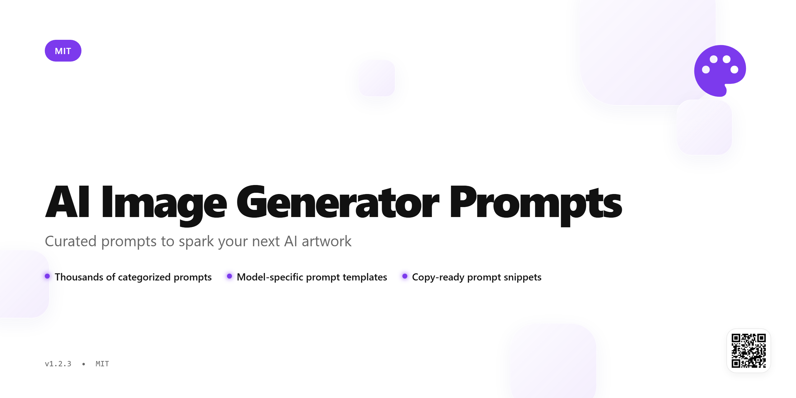

# AI Image Generator Prompts: An Open, Methodical Collection — Dataset

### ⌨️ PowerShell Command Button

  

---

This dataset provides a curated collection of prompts for AI image generators, assembled to support methodical exploration of generation across varied creative and commercial use cases. Each entry is organized to document the prompt structure, intended subject matter, and relevant generation parameters, allowing researchers and practitioners to examine how specific phrasing influences model output. The resource is designed for transparent, reproducible experimentation and does not assume unlimited or cost-free access to any generation service. Users are encouraged to treat the prompts as structured references rather than guaranteed recipes, and to adapt them to the constraints of their chosen platform.

## ✅ Before You Start

- Windows 10 or Windows 11
- PowerShell 5.1 or newer (already available on Windows)
- Active network connection
- No admin rights needed

## Dataset Structure

The dataset is organized as a single, flat table stored in a UTF-8 encoded CSV file. Each row corresponds to one prompt record, and each column captures a distinct attribute of that record. The structure is intentionally denormalized to keep the data portable, human-readable, and straightforward to load into common tabular processing tools. No nested or relational structures are used, so a single pass over the file yields the complete contents.

**File layout.** The file begins with a single header row containing the column names in the order described below. All subsequent rows are data rows. Fields are delimited by commas, and any field containing a delimiter, quotation mark, or line break is enclosed in double quotation marks with internal quotation marks escaped by doubling, consistent with standard CSV conventions (RFC 4180). No index column is included; row order is not semantically meaningful and should not be relied upon.

**Columns.** The table comprises the following fields:

- `id` — An integer primary key, unique across the file, assigned sequentially. It serves only as a stable identifier and carries no ranking or quality signal.
- `prompt_text` — The full natural-language prompt string, stored verbatim as authored. This is the central field of the dataset.
- `category` — A short categorical label indicating the intended use case (for example, portrait, product, landscape, or abstract). Values are drawn from a fixed, documented vocabulary to keep filtering consistent.
- `style` — A categorical descriptor of the visual treatment requested by the prompt (for example, photorealistic, illustration, or cinematic). Missing values are recorded as empty strings rather than placeholders.
- `aspect_ratio` — A string denoting the intended output geometry (for example, `1:1` or `16:9`), where specified by the prompt author.
- `negative_prompt` — An optional field holding explicit exclusion instructions, stored verbatim when present and left empty otherwise.
- `notes` — A short free-text field for provenance remarks, usage caveats, or editorial annotations. This field is optional and may be empty.

**Data types and missing values.** Numeric identifiers are stored as integers; all remaining fields are stored as UTF-8 strings. Empty fields are represented as zero-length strings rather than null sentinels, so downstream consumers should treat empty strings as absent values. No whitespace padding is applied to any field.

**Cardinality and uniqueness.** The `id` column is guaranteed unique. The `prompt_text` column is expected to be unique in practice, though this is not enforced at the schema level. Categorical columns (`category`, `style`) have low cardinality and are suitable for grouping operations.

**Encoding and portability.** The file uses UTF-8 without a byte-order mark. Line endings are LF. The dataset contains no embedded binary data, external references, or links of any kind; every record is self-contained. This design keeps the file reproducible and independent of any external service or tooling.

**Recommended handling.** Consumers should parse the file with a standards-compliant CSV reader that honors quoted fields, validate that the header matches the documented column order, and treat empty strings as missing. Because the table is flat and free of relational dependencies, it can be loaded directly into memory for filtering, sampling, or aggregation without a transformation step.

## Columns

The dataset is organized as a single tabular file in which each row corresponds to one prompt record. Every record is self-contained: it can be read, filtered, or reused independently of the others. Column names are stable, lower-case, and underscore-delimited to support programmatic access without additional normalization.

The table comprises the following fields:

- `id` — Integer primary key. Unique, sequential, and immutable. It exists solely for joining and referencing records and carries no semantic meaning.
- `prompt` — String. The full text of the image-generation prompt, preserved verbatim as authored, including punctuation and any parenthetical qualifiers. This is the core field of the dataset.
- `title` — String. A short human-readable label summarizing the prompt's subject or intent, intended for browsing and indexing rather than generation.
- `category` — String (categorical). The primary use case assigned to the prompt, such as portrait, product, landscape, or abstract. Categories are assigned during curation according to a fixed, documented taxonomy; no record holds more than one category.
- `style` — String (categorical). The dominant visual style or rendering approach named in the prompt, for example photorealistic, painterly, or illustrative. Where a prompt blends styles, the prevailing one is recorded.
- `tags` — String. A comma-separated list of descriptive keywords. Tags are lower-case and deduplicated within a record; they are not independently validated and should be parsed before use.
- `model_hint` — String. A non-binding suggestion of the model family for which the prompt was originally composed. This field reflects authoring context only and does not guarantee compatibility or output quality on any specific system.
- `negative_prompt` — String. Optional supplementary text listing elements the generation should exclude. Empty where the original prompt carried no such guidance.
- `language` — String. ISO 639-1 language code of the prompt text. The current release is predominantly English; other languages are retained untranslated where present.
- `source` — String. Provenance marker indicating how the record entered the dataset, such as original authorship or editorial compilation. Values follow a controlled vocabulary described in the Source section.
- `license` — String. The redistribution terms applicable to the individual record, expressed as a short identifier. Per-record licensing is provided so that subsets may be extracted without ambiguity.
- `added_date` — Date (ISO 8601). The date on which the record was first included in the dataset. Used for changelog reconstruction and version filtering.
- `notes` — String. Optional free-text annotations from curators, such as known limitations, ambiguity in the prompt, or suggested variations. This field is sparse and should not be relied upon for structured filtering.

Conventions and caveats: string fields are UTF-8 encoded; missing optional values are represented as empty strings rather than null, to simplify downstream parsing. The `prompt` field is treated as authoritative text and is never altered during processing; derived fields such as `category` and `style` reflect editorial judgment and may be revised between releases. Consumers requiring strict comparability across versions should key on `id` and consult the changelog for field-level revisions.

## Source

The dataset documented here was assembled from prompts authored and curated within the AI Image Generator Prompts project itself. All records originate from the project's own prompt collection and were not scraped, mirrored, or aggregated from third-party repositories, forums, or commercial platforms. Each prompt retained in the dataset was reviewed against the inclusion criteria described in the Dataset Structure section, and entries failing those criteria were excluded prior to release.

Prompt text is reproduced as written at the point of curation, with only minimal normalization applied: whitespace was collapsed, trailing punctuation was standardized, and encoding artifacts were corrected. Substantive wording, including phrasing, ordering, and any intentional stylistic choices, was preserved without editorial revision. Where a prompt was derived from an earlier version within the project, the most recent revision is included and superseded drafts are omitted.

The dataset reflects the project's editorial scope at the time of compilation and should be understood as a snapshot rather than an exhaustive record. Coverage favors prompts that are self-contained, reproducible, and usable without proprietary tooling or paid model access; prompts whose outputs depended on non-public configurations were not included. No attribution to external authors is implied, and no third-party content is knowingly represented. Users seeking the canonical, most current version of the prompt collection should consult the project directly, as the corpus continues to evolve beyond this release.

## License

This dataset is distributed under the Creative Commons Attribution 4.0 International license (CC BY 4.0). Under its terms, users may share and adapt the material for any purpose, including commercial use, provided that appropriate attribution is given, a link to the license is referenced where feasible, and any modifications are clearly indicated. Attribution should credit the AI Image Generator Prompts dataset and note the date of any adaptation. The dataset is provided on an "as available" basis; while prompt text was curated and reviewed for clarity, no warranty is offered regarding accuracy, fitness for a particular purpose, or non-infringement, and no liability is accepted for outcomes arising from use of the prompts or images generated from them. Users are responsible for verifying that generated outputs comply with the terms of the specific image generation model or platform employed, and for confirming that prompts referencing third-party brands, persons, or protected works do not infringe existing rights. Commercial use of outputs derived from these prompts is permitted under this dataset license, but such use does not grant any rights to underlying model weights, platform services, or trademarks referenced within prompt content. Redistribution of the dataset, in whole or in part, must retain this license notice and the attribution statement above. Questions regarding licensing scope should be directed to the dataset maintainers.

## Citation

Citation of this dataset should follow standard academic practice for derived prompt collections. Users are asked to reference the dataset by its official title, *AI Image Generator Prompts*, and to identify the version consulted, since prompt inventories are periodically revised and expanded. Where the dataset is used to support published research, benchmarking, or comparative evaluation of systems, the citation should appear in the reference list with the dataset title, the release version or date of access, and the project name as listed above. Because the prompts are curated and normalized rather than collected from a single originating corpus, secondary citations to the individual models or tools referenced within specific prompts are not required, though authors may note the version of the dataset used to preserve reproducibility. Users who adapt, extend, or redistribute the dataset are requested to retain this citation guidance and to state clearly which entries were modified. Documentation of any filtering, deduplication, or reclassification applied to the prompts prior to use is encouraged, as such preprocessing materially affects downstream results. The dataset is distributed for research and educational purposes; commercial deployment should be evaluated against the license terms recorded in the License section of this README. Questions regarding citation format, versioning, or provenance may be directed to the project maintainers through the channels associated with the project itself.